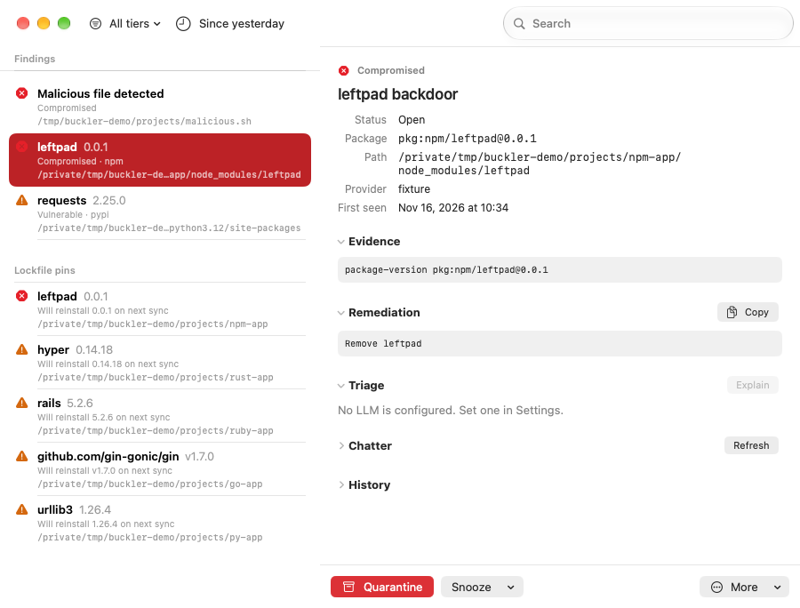
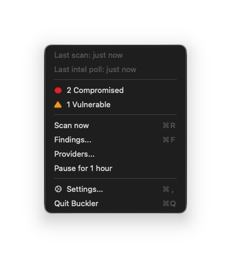
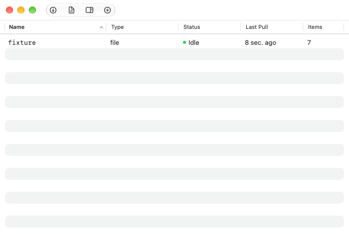
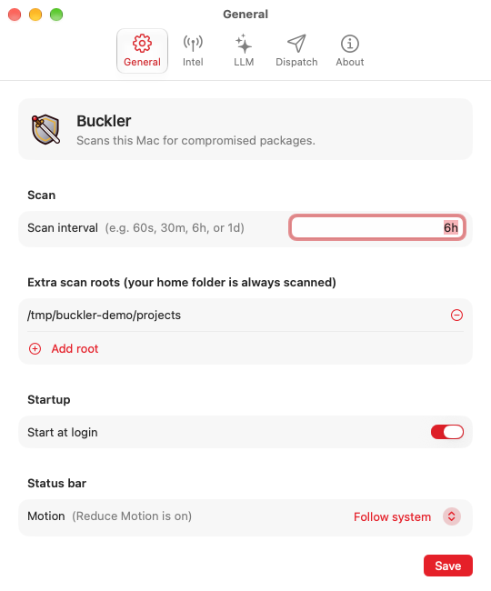

# Buckler

Buckler is a menu bar app for macOS. It finds the software that is installed on your Mac and compares it with supply-chain threat intelligence. When a package that you have is compromised or vulnerable, Buckler tells you which copy it is, where it is, and what to do.

<p align="center">
  <picture>
    <source media="(prefers-color-scheme: dark)" srcset="images/findings-dark.png">
    
  </picture>
</p>

## Install

Buckler needs macOS 15 (Sequoia) or later.

```bash
brew tap caretak3r/buckler
brew trust caretak3r/buckler
brew install --cask caretak3r/buckler/buckler
xattr -dr com.apple.quarantine /Applications/Buckler.app
```

The cask installs `Buckler.app` in `/Applications` and links the `buckler` command line tool.

Homebrew loads casks from a third-party tap only after you trust the tap. The app is not notarized yet, so Gatekeeper refuses it while it has the quarantine attribute. The `xattr` command removes this attribute.

To update, run `brew upgrade --cask caretak3r/buckler/buckler`, then run the `xattr` command again.

## What Buckler does

- It makes one inventory of Homebrew, npm (npm, pnpm, yarn, bun), pip, uv and pipx, Cargo, Go, RubyGems, VS Code and Cursor extensions, Docker images, and host artifacts: LaunchAgents, `.pth` files, `authorized_keys` and shell rc files.
- It pulls threat intelligence from OSV, GitHub Advisories, CISA KEV, RSS feeds and local indicator files. Providers are plain TOML.
- It matches deterministically. The LLM extracts indicators from news and writes summaries. It never decides a finding and never sees your inventory.
- It puts each finding in one of five tiers: compromised, exploited, vulnerable, host change and advisory. A compromised finding gives a notification immediately.
- For each finding, you can quarantine (reversible), delete, update, snooze, or dispatch a task to a coding agent.
- Your inventory stays on your Mac. API keys stay in the Keychain.

## Screenshots

<table>
  <tr>
    <td width="33%">
      <picture>
        <source media="(prefers-color-scheme: dark)" srcset="images/status-menu-dark.png">
        
      </picture>
    </td>
    <td width="33%">
      <picture>
        <source media="(prefers-color-scheme: dark)" srcset="images/providers-dark.png">
        
      </picture>
    </td>
    <td width="33%">
      <picture>
        <source media="(prefers-color-scheme: dark)" srcset="images/settings-general-dark.png">
        
      </picture>
    </td>
  </tr>
  <tr>
    <td>Status menu</td>
    <td>Providers</td>
    <td>Settings</td>
  </tr>
</table>

## Documentation

The documentation is at [silent.engineer/buckler](https://silent.engineer/buckler/):

- [Get started](https://silent.engineer/buckler/guide/)
- [Menu bar](https://silent.engineer/buckler/guide/menu-bar/) and [Findings window](https://silent.engineer/buckler/guide/findings/)
- [Actions](https://silent.engineer/buckler/guide/actions/) and [tiers](https://silent.engineer/buckler/concepts/tiers/)
- [Command line](https://silent.engineer/buckler/guide/cli/)
- [config.toml](https://silent.engineer/buckler/reference/config-toml/)

## Releases

The [Releases](https://github.com/caretak3r/homebrew-buckler/releases) page has a zip file for each version. This repository holds the Homebrew cask and the release files. The source code is not public.
